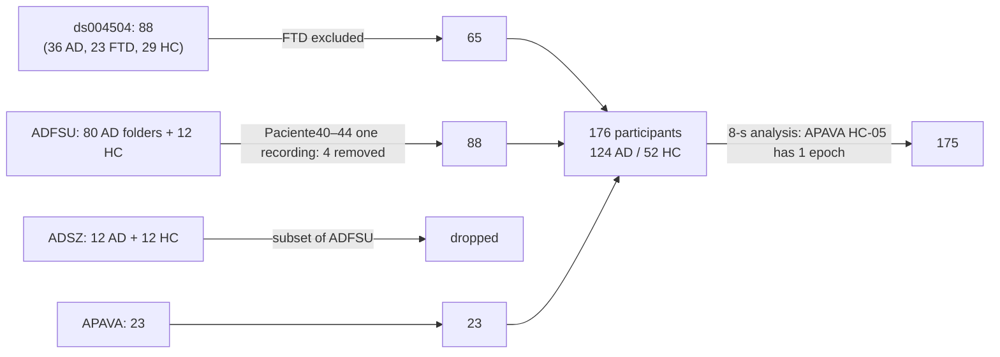
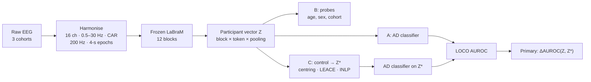

# Demographic and acquisition information in a frozen EEG foundation model, and what it means for cross-cohort Alzheimer's disease classification

*Final report draft for the mentor (Phase 12, T12.8). Every number below comes from a committed
result table or experiment README; the source is given in brackets. All numbers were re-checked
against the tables on 12 November 2026.*

---

## Abstract (draft)

**Background.** Frozen EEG foundation models can separate Alzheimer's disease (AD) from healthy
controls (HC), but EEG also carries age, sex and recording-system information that could act as a
shortcut. **Objective.** To measure how much demographic and cohort (acquisition) information a
frozen LaBraM model encodes, remove it, and test whether AD classification still transfers to an
unseen cohort. **Methods.** 176 participants from three public resting-state, eyes-closed EEG cohorts
(ds004504, 36 AD / 29 HC; ADFSU, 76 / 12; APAVA, 12 / 11) were harmonised to 16 channels, 0.5–30 Hz,
200 Hz and 4-s epochs. Frozen LaBraM-base embeddings were pooled per participant and classified with
class-weighted logistic regression, with block, pooling and regularisation chosen by inner
cross-validation on training participants. Linear probes
measured age, sex (ds004504) and cohort information. Cohort information was removed with
prevalence-balanced cohort centring (primary), LEACE and INLP, all fitted inside training folds.
The primary outcome was the change in leave-one-cohort-out (LOCO) AUROC, mean over three folds, with
a paired participant bootstrap. The analysis plan was frozen in the public code repository before
any held-out result (not externally registered).
**Results.** LaBraM transferred across cohorts (mean LOCO AUROC 0.853, 95% CI 0.773–0.922; the first
transformer block was selected in every fold), but no better than classical spectral features (0.900). Age and sex were not decodable in ds004504; cohort
was (balanced accuracy 0.88, chance 0.33), more than from classical features (0.77). In the
pre-specified analyses, removing cohort information never reduced transfer: centring raised mean AUROC to 0.887 (ΔAUROC −0.034,
−0.069 to −0.001, p = 0.046), LEACE to 0.883 and INLP to 0.876. The small improvement disappeared
with equal EEG length per participant or equalised amplitude, and no secondary comparison survived
Holm correction. In exploratory analyses the cross-cohort AD score behaved as an EEG-slowing index:
removing theta cost most discrimination, removing the posterior channels cost far more than any
other region (ΔAUROC 0.20), and the score correlated with the theta/alpha ratio at up to ρ = 0.91. Which epochs were pooled per participant changed AUROC by up to several hundredths, with
no reliable effect of their position in the recording. **Conclusion.** Frozen LaBraM encodes its cohort strongly, but its cross-cohort AD signal
does not depend on that information. What transfers is largely the classical spectral slowing of AD.

---

## 1. Introduction

Alzheimer's disease is the most common cause of dementia. Resting-state EEG is cheap, non-invasive
and widely available, and the EEG of people with AD shows well-described changes, chiefly spectral
slowing, with more delta and theta power, less alpha and beta power and a slower alpha peak (Jeong, 2004; Babiloni et al., 2020). Machine-learning models can separate AD from
healthy controls using EEG. High accuracy alone does not show that a model has learned disease
neurophysiology: an EEG recording also carries the person's age and sex, and the signature of the
recording system and site. When any of these is correlated with diagnosis in the training data, it
can act as a shortcut.

Self-supervised EEG foundation models make the question sharper. They are pretrained on thousands of
hours of EEG from many datasets and then reused for clinical tasks, including dementia detection
(Jiang et al., 2024; Lin, Hou, & Jung, 2026). Their representations can encode dataset identity
almost perfectly (Zare, 2026) and subject identity strongly (Lin, Wu, Jung, et al., 2026). Whether
the *AD* signal in such a representation depends on that nuisance information has not been tested
across cohorts.

**Question.** When a frozen EEG foundation model classifies a participant as having AD, how much of
that prediction depends on demographic and acquisition (cohort) information, and does the AD signal
that remains after this information is removed still transfer to an unseen cohort?

**Objectives.**
- **O1** Baseline: AD vs HC from frozen LaBraM representations, within cohorts and leave-one-cohort-out, against a classical spectral comparator.
- **O2** Probe: how much age, sex (ds004504) and cohort information the representations carry.
- **O3** Control: remove that information with pre-specified, leakage-safe methods.
- **O4** Generalise: the change in cross-cohort AD performance after removal (primary outcome).
- **O5** Interpret (exploratory): which EEG properties the transferable AD signal reflects.

**Intended use.** This is a measurement study. Nothing here is a diagnostic tool, and no clinical
use is proposed.

## 2. Background

A fuller review is in `literature/draft_lit_review.md`; this section summarises it.

### 2.1 Validation in AD-EEG machine learning
Splitting epochs of one person between training and test sets lets a model recognise the person
rather than the disease. Segment-based splits strongly overestimated performance in an AD dataset,
and only 27% of surveyed translational deep-learning EEG studies clearly avoided this leakage
(Brookshire et al., 2024). In 46 studies on ds004504, mean accuracy fell from 90.8% to 82.1% when
only subject-level validation was counted, and classical algorithms matched deep models once
validation was sound (Miltiadous et al., 2026). Across AD deep learning, only 15.9% of studies
validated on an independent dataset and 79.5% did not control for confounders (Young & Salardini,
2025), and only 17 of 92 interpretable dementia models were tested on data from an external source
(Martin et al., 2023). Where cross-centre testing has been done with classical features, AD versus
controls transferred well across five sites in Latin America and Turkey, driven by reduced alpha and
raised theta and delta markers, while controls versus mild cognitive impairment fell to chance in
some centres (Belloli et al., 2026). A convolutional network trained at one hospital separated
healthy from mixed dementia at balanced accuracy 0.81 and 0.92 at two others, but those hospitals
contributed only 3 and 0 healthy controls, so the figures mostly measure sensitivity in patients
(Watanabe et al., 2024). Subject-level splitting is therefore necessary but not
sufficient: it does nothing about confounds that differ *between* groups of participants, such as
age, sex and cohort.

### 2.2 What EEG foundation models encode
LaBraM is a transformer pretrained by masked EEG modelling on 1-s channel patches, with a neural
tokenizer trained to reconstruct Fourier amplitude and phase, on about 2,500 hours of EEG from
around 20 datasets (Jiang et al., 2024). Pretrained LaBraM
embeddings separated dementia (subtype not stated) from controls at AUROC 0.89 with a random-forest
read-out in a private four-centre Taiwanese cohort of eyes-open EEG; logistic regression and a linear
SVM on the same embeddings were near chance (Lin, Hou, & Jung, 2026). Frozen foundation-model
representations also encode subject identity (Lin, Wu, Jung, et al., 2026; Madapura, Kommineni, &
Narayanan, 2026) and dataset identity (Zare, 2026). Tang et al. (2026) showed that a feature can be
encoded without being used, by erasing hand-crafted spectral and connectivity features from LaBraM,
CBraMod and CSBrain on depression, stress, sleep and seizure tasks; nuisance variables such as site,
age or sex were not erased, and no AD or cross-dataset task was included. Two controlled evaluations
found that pretraining buys less than expected: on a Korean dementia cohort, classical features
(AUROC 0.73) beat five frozen encoders (0.53–0.68; Zare, 2026), and with validation-selected
probes, random initialisation matched or beat pretraining for three of six models on sleep and
emotion tasks, though not for LaBraM (Jeon, Cho, & Suh, 2026), and across 42 clinical and BCI
datasets EEG-specific foundation models did not consistently outperform generic time-series ones,
with pretraining adding a small but consistent margin over random initialisation (Kontras et al.,
2026). The same holds for nuisance
information: in brain MRI, an untrained copy of a foundation model predicted scan site as well as
the pretrained one (Rahbar, 2026). Linear probing is not the most
accurate way to use these models (Liu et al., 2026), and in Lin, Hou and Jung's cohort it failed
outright, but it measures what is already available in the representation without adding a
flexible model that could learn new shortcuts. Here, linear read-outs reached AUROC 0.82–0.93
within cohorts (§4.2), so the linear choice did not leave the AD signal out of reach.

### 2.3 Demographic and acquisition confounds
Age and sex are decodable from EEG given enough data: on more than 2,600 recordings, brain signals
predicted age at R² up to about 0.8 and sex at AUC close to 0.9 in one archive (lower in the other),
with eye-movement channels alone reaching AUC 0.70 for sex (Bomatter et al., 2024), and a small
network read sex at 65–80% balanced accuracy across three clinical
archives (Darvishi-Bayazi et al., 2026). Sex can become a hidden confounder in disease classifiers
(Jochmann et al., 2023), although Darvishi-Bayazi et al. found sex-specific patterns contributed
little to abnormal-EEG detection.

Multicentre dementia-EEG classifiers have not tested whether their signal depends on demographics.
Prado, Mejía, et al. (2023) harmonised two centres by per-centre normalisation, classified pooled
data, and name "the lack of steps to control the effects of demographic covariates" as their main
limitation. Belloli et al. (2026) adjust for age, sex and education only when relating predictions
to cognitive scores, not in the classifier, and note that residual hardware and cohort differences
"may still influence performance". Watanabe et al. (2024) found that controls their EEG-only network
misclassified were older than those it classified correctly (median 73 vs 64 years), judged the
effect negligible, and report external-hospital accuracy with 3 and 0 controls at those hospitals;
adding age, sex and MMSE as inputs was tried and lowered accuracy. None removes demographic or
centre information from the model and re-tests. In ds004504, 24 of 36 AD participants are female against 11 of 29 controls (Fisher
p = 0.026). Normal ageing also changes the EEG, including slower and weaker alpha and a flatter aperiodic spectrum (Ishii et al., 2017; Voytek et al., 2015); ds004504's groups are age-matched
(66.4 ± 7.9 vs 67.9 ± 5.4 years). Public AD-EEG cohorts differ in amplifier, montage, reference,
sampling rate, source filtering, recording length, era and diagnostic mix. Within a cohort these
are constant, so they are inseparable from cohort identity, which this project treats as the
acquisition nuisance variable.

### 2.4 Removing information from representations
Options range from residualisation and per-site centring, common in neuroimaging harmonisation
(ComBat: Johnson, Li, & Rabinovic, 2007; Fortin et al., 2018; applied to resting EEG features of healthy
adults across five datasets by Jaramillo-Jimenez et al., 2024, without a patient group; and before
pooled classification of Alzheimer's-risk carriers by Henao Isaza et al., 2026, without a held-out
site or a with/without comparison), to concept erasure: iterative nullspace projection (INLP;
Ravfogel et al., 2020) and LEACE, after which no linear classifier can predict the concept better
than a constant (Belrose et al., 2023). Erasure has been applied to frozen EEG embeddings for
acquisition signatures in non-clinical tasks, where Aimoldin et al. (2026) warn that "source
predictability alone does not identify what should be removed: it can reflect measurement effects or
genuine biological and population differences, which should not be erased", and where LEACE lowered
task AUROC from 0.75 to 0.66 while barely reducing source information. The nearest test of removal on foundation-model embeddings is in resting-state fMRI: ComBat on
BrainLM and SwiFT embeddings cut site decodability from about 90% to 25–30% with linear probes
while diagnosis accuracy stayed "essentially unaffected" for BrainLM, fell by about 10 points for
SwiFT, and a non-linear probe still recovered 52–64% of site information (Tao et al., 2026).
Adversarial site-invariance objectives are the alternative to post-hoc removal; for depression
across seven sites one gave 10.7 points of balanced accuracy under zero-shot site transfer, with an
encoder trained by the authors (Wong et al., 2026). Two problems are specific to cross-cohort EEG. Demographic
control needs demographics for everyone it is applied to, and only ds004504 has them. Cohort
centring on raw means would subtract disease signal from AD-heavy cohorts, so cohort means must be
prevalence-balanced.

### 2.5 Gap
Foundation-model audits so far probe nuisance information but do not remove it and re-test. Zare
(2026) trains and tests every clinical probe within one dataset and states that the external-cohort
arm "is not external validation of a fitted clinical model"; Tang et al. (2026) erase features, not
nuisance variables, within one dataset; Aimoldin et al. (2026) remove acquisition signatures but
for SSVEP and ERP tasks with no clinical label; and Lin, Wu and Jung (2026) erase subject identity
from LaBraM on ds004504 but leave the effect on the AD label undefined, because in a single-session
cohort the diagnosis is a per-subject constant that lies inside the identity subspace. No study has
removed cohort, site, age or sex information
from a foundation-model representation and measured the effect on a clinical label in a cohort the
model was not trained on, with a positive control showing that the removal works. The closest clinical comparator is Belloli et al. (2026): the same leave-one-centre-out design,
739 people across six cohorts, classical features, and the same descriptive conclusion that alpha
loss and slowing transfer; what it lacks is the removal step. That is the contribution here. Two
further gaps surfaced during the work: public AD-EEG datasets are treated as
independent when they are not (§4.1), and recording length has not been studied as a between-cohort
confound (§5.3).

## 3. Methods

The design was fixed in `docs/protocol.md` and frozen as git tag `analysis-plan-v1` on
11 November 2026, before any held-out result. Every later choice is in `docs/decision_log.md` with
whether it was made before or after seeing results. Each experiment's design was committed before
it was run (`experiments/EXP-xxx/README.md`, "Before running").

### 3.1 Cohorts

**Table 1. Cohorts** (`results/tables/T01_cohort_summary.csv`, `docs/datasets.md`)

| Cohort | Source | AD / HC | Original rate, channels | Eyes-closed EEG per person, median | Age, sex |
|---|---|---|---|---|---|
| ds004504 | OpenNeuro, Miltiadous et al. (2023) | 36 / 29 | 500 Hz, 19 ch, linked ears | 829 s (AD), 827 s (HC) | yes: 66.4 ± 7.9 / 67.9 ± 5.4 y; 24/36 and 11/29 female |
| ADFSU | Vicchietti et al. (2023); recordings from the FSU database (Pritchard, Duke, & Coburn, 1991) | 76 / 12 | 128 Hz, 19 ch, cleaned and band-limited at source | 8 s | no |
| APAVA | Smith, Abásolo, & Escudero (2017); Escudero et al. (2006)ᵃ | 12 / 11 | 256 Hz, 16 ch, common average | 168 s (AD), 140 s (HC); 5-s trials | no |

ᵃ LEAD (Wang et al., 2025) attributes APAVA to Escudero et al. (2006), which reports 11 AD and 11 controls with 19 electrodes. The released set (12 AD, 11 HC, 16 channels, 5-s epochs at 256 Hz) matches the description in Smith et al. (2017): patients from the Alzheimer's patients' relatives association of Valladolid, recorded at the University Hospital of Valladolid, Spain, with artefact-free epochs selected by a specialist. The OSF copy (jbysn) is labelled as the data of Smith et al. (2017), "based on Escudero et al.".

**Recording dates** (TRIPOD+AI 5b) are not reported by any of the three sources. Inferred eras: ADFSU before 1991 (first described by Pritchard et al., 1991); APAVA before 2006; ds004504 not stated (ethics approval for the release dates from April 2023).

Only AD and HC with eyes-closed resting EEG were used. FTD participants in ds004504 were excluded. A
fourth candidate cohort, ADSZ, turned out to be a subset of ADFSU (47 of 48 files identical) and was
dropped; four duplicated ADFSU AD recordings were removed (D-017, EXP-002). Total: 176 participants
(124 AD, 52 HC).

**F2. Participant flow**

Counts from EXP-002 and `docs/datasets.md`.

### 3.2 Preprocessing

**Table 2. Preprocessing** (D-002 to D-005, D-012 to D-022; `configs/preprocessing.yaml`)

| Step | Choice | Reason |
|---|---|---|
| Condition | eyes-closed rest only | avoid condition shortcuts (D-002) |
| Channels | 16 common (10–20 minus Fz, Cz, Pz) | APAVA lacks the midline (D-003) |
| Band-pass | 0.5–30 Hz, 4th-order zero-phase Butterworth, per continuous segment | narrowest source band (ADFSU); IIR works on 5-s trials (D-004, D-020) |
| Reference | common average | source references differ (D-012) |
| Resampling | 200 Hz | LaBraM input rate (D-005) |
| Epochs | 4 s, never crossing segment boundaries | fits 5-s and 8-s trials (D-015, D-021) |
| Rejection | > 150 µV peak-to-peak, or flat (< 0.5 µV); same rule for every cohort; no ICA | trials too short for ICA (D-013) |
| Amount kept | all clean epochs (8-s crop as sensitivity) | more signal; risk recorded (D-018) |
| Units | µV, divided by 100 for LaBraM | LaBraM convention (D-019, D-022) |

No participant lost all epochs. Clean epochs per participant: ADFSU always 2; APAVA median 33 (AD)
and 28 (HC), range 1–59; ds004504 median 178 and 192, range 68–322. In ds004504 more AD than HC
epochs were rejected (12.6% vs 8.2%) (EXP-003).

### 3.3 Representations
LaBraM-base, frozen, dropout off, was run on every clean epoch with the authors' input conventions
(D-022). For each of the 12 transformer blocks we kept the mean over patch tokens and the CLS token,
and pooled epochs to one vector per participant by mean or median: 12 × 2 × 2 candidate
200-dimensional representations. The same model with random weights was a negative control
(EXP-013). The classical comparator was 80 features: relative band power (delta 1–4, theta 4–8,
alpha 8–13, beta 13–30 Hz) per channel and the aperiodic exponent per channel (EXP-012).

### 3.4 Classifier and validation
Class-weighted L2 logistic regression after median imputation and standardisation. Block, token,
pooling and C ∈ {0.001 … 100} were chosen by inner 5-fold CV AUROC on training participants only
(stratified by cohort × diagnosis in LOCO; D-024). The participant is the unit of splitting
throughout (D-001).
- **Within cohort:** stratified 5-fold × 10 repeats.
- **Leave-one-cohort-out (LOCO):** train on two cohorts, test on the third; three folds.

### 3.5 Nuisance probes and controls
**Probes** (O2): age (ridge; MAE) and sex (logistic; AUROC) within ds004504; cohort (multinomial
logistic; balanced accuracy) on all 176. Nested selection as above; permutation tests for age and
sex (D-029); a one-hidden-layer MLP as a nonlinear check (EXP-022).

**Controls** (O3), each refitted inside every inner and outer training fold (D-031):
- **Cohort centring (primary):** subtract each training cohort's prevalence-balanced mean (the
  average of its AD mean and HC mean, D-009). The held-out cohort is centred with (i) the pooled
  training mean, or (ii) its own label-free mean. Both give identical AUROC by construction (D-032).
- **LEACE:** closed-form linear erasure of one-hot training cohort (Belrose et al., 2023).
- **INLP:** 20 iterations of logistic nullspace projection (Ravfogel et al., 2020).
- **Age/sex residualisation** within ds004504 (OLS on age and sex, fitted on all training
  participants, or on training HC only).

A representation controlled for both demographics and cohort was not built: held-out cohorts have no
age or sex (D-008).

### 3.6 Outcomes and statistics
**Primary outcome:** ΔAUROC = AUROC(original) − AUROC(centred, variant i), mean over the three LOCO
folds, with a 95% CI from a stratified participant bootstrap (2000 paired draws, each fold resampled
independently, seed 20261001) (D-026). Patterns were defined in advance (D-027): **A** CI includes 0;
**B** CI above 0 and controlled AUROC still above chance; **C** CI above 0 and controlled AUROC no
better than chance. A CI entirely below 0 (control improves transfer) was to be reported as its own
outcome.

**Secondary comparisons** (Holm, m = 6; D-028, D-034): centring (ii), LEACE, INLP, age/sex
residualisation, 8 s per participant, amplitude-scaled. p-values are two-sided bootstrap p-values
from the same replicates as the CIs. Per-fold AUROC CIs were cross-checked against DeLong's method.
Every headline number was recomputed from saved predictions (`scripts/10_stats.py`).

**Sensitivity analyses** (Phase 9): LOCO without ADFSU (EXP-041); ADFSU AD subsampled to 12, 100
draws (EXP-042); every participant cropped to the first 8 s (EXP-043); each participant's EEG scaled
to a common SD of 10 µV (EXP-044).

**Sample size.** Fixed by the public cohorts available; no formal calculation was possible. The
smallest held-out class is 11 HC (APAVA), so per-fold CIs are wide.

### 3.7 Data, ethics and reporting
Reporting follows TRIPOD+AI (Collins et al., 2024; `reports/checklists/tripod_ai.md`), and risk of bias was self-assessed with PROBAST (Wolff et al., 2019), with the AI-specific signalling questions of PROBAST+AI (Moons et al., 2025) (`reports/checklists/probast.md`). Secondary analysis of public, de-identified datasets under their published terms
(`docs/licences/`). No data are redistributed. Code is public; `README.md` gives the run order.

### 3.8 Exploratory interpretation (O5)
Added or re-scoped after the confirmatory results and labelled exploratory (D-035 to D-038):
- **EXP-053:** pool only the first k epochs of each recording, k = 1 … all.
- **EXP-054:** 8 epochs from the first, middle or last part of each recording; k ∈ {2, 8, 32} randomly drawn epochs, 5 draws.
- **EXP-050:** band-stop one band in the held-out cohort's EEG and re-apply the trained classifier.
- **EXP-052:** correlate the out-of-fold AD score with classical markers within each held-out cohort (Spearman, BH-FDR).
- **EXP-051:** zero one channel, or one region (frontal Fp1 Fp2 F7 F3 F4 F8; central-temporal T3 C3 C4 T4; posterior T5 P3 P4 T6 O1 O2), in the held-out cohort's average-referenced EEG and re-apply the trained classifier. After average referencing, zero is the montage average, so the channel stays in the input but carries no signal of its own. First deferred for time (D-036), then run with its design and reading rule committed before any occluded embedding existed (D-038).

**F1. Pipeline**

## 4. Results

### 4.1 Harmonised data
**Duplicate public datasets.** ADSZ is a copy of part of ADFSU: 47 of its 48 files are identical to
ADFSU recordings (EXP-002). Both are distributed and cited as separate datasets. LEAD (Wang et al.,
2025) lists ADFSU (92 subjects) and ADSZ (48) as two of its five downstream evaluation sets and
reports 100% subject-level F1 and AUROC on each, as do the other models in its comparison, and a
2026 review of AD detection tabulates them as separate cohorts (Huang, Su, Wang, & Yao, 2026). We
found no report of the overlap. A benchmark that counts both treats the same 24 people as two
independent tests. The secondary literature is also confused about what these data are: Saeed and
Aldera (2026) describe ADFSU as a 256-Hz, ten-minute recording from São Paulo State University,
when it is the 128-Hz, 8-s Florida State University data that São Paulo redistributed, and give
500-Hz ds004504 as 256 Hz. (LEAD's pretraining data do not include ADFSU, ADSZ, APAVA or ds004504, so this
does not affect its held-out claims, only their number.)

After the common pipeline, amplitudes converged (robust SD 6.0–6.8 µV in ds004504 and ADFSU, 4.8–6.2
in APAVA, from 18.3 / 7.7 / 4.9 µV raw). All cohorts showed the expected spectra: a 10-Hz alpha peak
in HC and a flatter, slower spectrum in AD (**F3**, `results/figures/EXP-003_psd_processed.png`).
Cohort was still decodable from classical spectral shape at balanced accuracy 0.69 (chance 0.33;
64 shape-only features, EXP-003). The 0.77 for classical features in Table 4 uses the 80-feature set
and the nested pipeline of the main analysis (EXP-021).

### 4.2 Baseline AD classification (O1)

**Table 3. AD vs HC AUROC** (EXP-010 to EXP-013; `T06_within_cohort.csv`, `T06_loco.csv`)

| | ds004504 | ADFSU | APAVA | Mean over LOCO folds [95% CI] |
|---|---|---|---|---|
| Within cohort, LaBraM (mean ± SD over repeats) | 0.821 ± 0.030 | 0.925 ± 0.043 | 0.821 ± 0.040 | – |
| Within cohort, classical | 0.821 ± 0.020 | 0.877 ± 0.036 | 0.817 ± 0.019 | – |
| LOCO, LaBraM (held-out cohort) | 0.870 | 0.810 | 0.879 | **0.853 [0.773, 0.922]** |
| LOCO, classical | 0.867 | 0.939 | 0.894 | 0.900 [0.832, 0.956] |
| LOCO, LaBraM with random weights | 0.805 | 0.870 | 0.841 | 0.838 [0.759, 0.907] |

- Frozen LaBraM separates AD from HC within every cohort and **transfers to unseen cohorts** (mean
  LOCO AUROC 0.85).
- **Classical spectral features transfer at least as well** (LaBraM − classical −0.047 [−0.096,
  −0.004]), mainly in the ADFSU fold. An **untrained LaBraM** comes close too (pretrained − random
  +0.015 [−0.055, 0.090]).
- In all three LOCO folds the inner CV chose **block 1**, the representation closest to the input
  spectrum.
- Demographics alone barely predict AD in ds004504 (age + sex AUROC 0.61 [0.46, 0.74]; an age-only
  baseline gave 0.56 and adding age to EEG features did not help in Das & Chakravarty, 2026). Our
  within-ds004504 LaBraM AUROC (0.82) matches leave-one-subject-out connectivity features on the
  same data (0.82; Mlinarič et al., 2026). Knowing only
  the cohort gives 0.65 on pooled data, because AD prevalence differs by cohort; LOCO removes that
  shortcut by construction.
- Pooled AUROC (0.79) is below the per-fold mean (0.85): predicted probabilities sit at different
  levels in different cohorts, a calibration-level cohort effect.

### 4.3 Nuisance information in LaBraM (O2)

**Table 4. Probes** (EXP-020 to EXP-022; `T07_*.csv`)

| Probe | Pretrained LaBraM | Random LaBraM | Classical | Reference |
|---|---|---|---|---|
| Age in ds004504, MAE (years) | 6.05 | 6.16 | 5.77 | guessing the mean 5.71 |
| Sex in ds004504, AUROC [95% CI] | 0.52 [0.38, 0.66] | 0.54 [0.39, 0.67] | 0.53 [0.39, 0.67] | 0.5 |
| Cohort, all 176, balanced accuracy | **0.879 ± 0.006** | 0.773 ± 0.027 | 0.769 ± 0.031 | chance 0.333 |

- **Age and sex were not decodable** in ds004504 (permutation p = 0.21 for both). With 65 people and
  an age SD under 7 years, this means "not detectable at this sample size", not "absent": both are
  decodable from EEG in samples of thousands (Bomatter et al., 2024).
- **Cohort was strongly decodable**, more from pretrained LaBraM than from classical features or the
  untrained network. Pretraining adds acquisition information beyond what spectral shape carries.
- **Cohort information grows with depth** (**F4**, `EXP-021_layer_profile.png`): 0.71 at block 1,
  0.86–0.89 at blocks 8–12; the random network is flat at 0.79. The LOCO AD classifier chose the
  block with the *least* cohort information.
- A nonlinear MLP probe found no more than the linear probes; it underfit at this sample size, so it
  is a weak check (EXP-022).

### 4.4 Removing nuisance information (O3, O4)

**F5** (`results/figures/F5_loco_auroc.png`) shows per-fold and mean LOCO AUROC for the original
representation and each cohort control.

**Table 5. Primary outcome and secondary comparisons** (EXP-030 to EXP-044; `T10_tests.csv`,
`T09_primary_and_sensitivity.csv`). ΔAUROC = original − controlled; negative means control improved transfer.

| Comparison | Original → controlled AUROC | ΔAUROC [95% CI] | p | Holm p |
|---|---|---|---|---|
| **Primary: centring (i), LOCO** | 0.853 → 0.887 | **−0.034 [−0.069, −0.001]** | **0.046** | tested alone |
| 1 Centring (ii) | 0.853 → 0.887 | −0.034 [−0.069, −0.001] | 0.046 | 0.28 |
| 2 LEACE | 0.853 → 0.883 | −0.030 [−0.081, 0.016] | 0.24 | 0.92 |
| 3 INLP | 0.853 → 0.876 | −0.023 [−0.071, 0.020] | 0.31 | 0.92 |
| 4 Age/sex residualisation, ds004504 | 0.821 → 0.775 | +0.042 [−0.026, 0.118] | 0.23 | 0.92 |
| 5 8 s per participant | 0.928 → 0.922 | +0.005 [−0.001, 0.014] | 0.11 | 0.55 |
| 6 Amplitude-scaled | 0.861 → 0.853 | +0.009 [−0.037, 0.060] | 0.76 | 0.92 |
| 7 Without ADFSU | 0.874 → 0.874 | not estimable (one training cohort; D-033) | – | – |
| 8 ADFSU AD subsampled, 100 draws | median 0.878 → 0.895 | median −0.017; 2.5–97.5%: −0.063 to 0.031 | – | – |

**F6** (`results/figures/F6_delta_auroc.png`) shows the same contrasts.

- **Primary outcome.** Centring did not hurt cross-cohort transfer; it improved it slightly. The CI
  lies just below 0, the pre-specified "control improves transfer" outcome (not pattern A, B or C).
- **Controls did what they were meant to.** LEACE removed linear cohort information completely
  (cohort probe at exactly chance), yet the AD classifier still transferred at 0.883. INLP removed
  most of it. Centring removed cohort means but left cohort decodable from the remaining structure.
  All three moved AUROC the same way (EXP-032).
- **After centring, the classifier chose deep blocks** (11–12) in two of three folds, among the
  more cohort-laden blocks (0.86–0.87, against 0.71 at block 1). Cohort offsets were an obstacle to using deep-block AD information, not a
  shortcut (EXP-031).
- **The improvement is not robust.** It halved when ADFSU was balanced (80% of draws still negative),
  and disappeared with 8 s per participant or equalised amplitude (pattern A in both). No secondary
  comparison survived Holm correction.
- **Age/sex residualisation** did not significantly change within-ds004504 AD performance. The HC-only
  variant *added* age and sex information (sex then decodable at AUROC 0.90): with about 23 controls
  per training fold, its coefficients were noise that wrote each person's own age and sex into the
  representation. It is not a valid control at this sample size (EXP-030).
- Without ADFSU, LaBraM still transferred between ds004504 and APAVA at 0.874, so the cross-cohort AD
  signal is not an ADFSU artefact (EXP-041).
- Bootstrap and DeLong CIs agreed (largest limit difference 0.029 over 22 fold CIs), and every
  headline value was reproduced from saved predictions (largest difference 0.00005).

### 4.5 What the transferable AD signal is (O5, exploratory)

**Amount of EEG and time in the recording (EXP-053, EXP-054).** Pooling only the first few epochs
gave *higher* AD discrimination than pooling all of them: LOCO AUROC 0.922 with 2 epochs and 0.908
with 8, against 0.853 with all (paired CIs above 0 only at 4 and 8 epochs; at 2 epochs +0.069
[−0.003, 0.149]). With 32 or 64 first epochs, transfer was slightly worse than with all (0.827, 0.829).
Within ds004504, AUROC rose too (0.882 with the first 2 epochs, 0.821 with all). More data per person
did make the cohort easier to recognise (block-11 probe 0.68 → 0.87). The effect of centring was not
stable across k: with 2 epochs per participant it *reduced* LOCO AUROC (0.922 → 0.861, ΔAUROC +0.062
[0.030, 0.097]), the one analysis in which cohort control hurt transfer.

A follow-up separated time in the recording from amount of data and supported neither (EXP-054,
`EXP-054_random_epochs.png`). Within ds004504 the *last* 8 epochs classified best (0.895, against
0.840 for the first 8), and fewer randomly drawn epochs did worse (0.777 with 2, 0.816 with 8, 0.827
with 32). Across cohorts, random subsets transferred slightly better than all epochs (means 0.868–0.880;
13 of 15 draws above 0.853), below the pre-set 0.03 threshold. AUROC varied by about ±0.03 between
random 8-epoch subsets within ds004504, and by up to 0.15 in the ADFSU fold, as much as the EXP-053
differences. The within-cohort "early epochs are best" pattern is therefore not reliable.

Band-stopping and channel-masking have been used before to explain a dementia classifier within one
dataset: Watanabe et al. (2024) found the beta band and the O1 electrode most important for their
four-class network. Here both are applied across cohorts, to the held-out cohort's input only.

**Band removal (EXP-050; F7, `EXP-050_band_perturbation.png`).** Removing **theta** (4–8 Hz) from the
held-out cohort's EEG cost the most discrimination (ΔAUROC +0.066 [0.026, 0.109]) and cut the
predicted AD probability of AD participants by 0.41 on average, four times the drop in HC. Most of
this came from the ADFSU fold (+0.16); in the other two cohorts the remaining bands still ranked
participants correctly. Removing delta cost a little (+0.020 [0.001, 0.043]). Removing beta raised
everyone's AD probability by about 0.20 without changing AUROC. Alpha mattered only for the
centred classifier.

**Channel occlusion (EXP-051; F8, `EXP-051_channel_occlusion.png`).** Zeroing the **posterior**
channels cut AUROC by 0.196 [0.119, 0.285] (centred classifier: 0.255 [0.166, 0.350]), most when
ADFSU or APAVA was held out. The frontal region, also six channels, cost 0.052 [0.004, 0.105], all
of it in the ADFSU fold, and the central-temporal region nothing (−0.010 [−0.051, 0.026]); by the
pre-set rule this is "posterior emphasis". Without posterior channels, controls looked more like AD
(predicted AD probability +0.21 in HC against +0.09 in AD). No single channel mattered much (largest
0.030): neighbouring posterior channels carry the same signal. The posterior emphasis agrees with
Watanabe et al.'s O1 result; the band differs (theta here, beta there), as expected between an AD vs
HC contrast across cohorts and a four-class dementia-subtype task within one.

**Classical markers (EXP-052).** **Table 6** (`T11_markers.csv`). Spearman ρ between the out-of-fold AD
score (centred classifier) and each marker within each held-out cohort; in brackets, the marker's own
correlation with diagnosis.

| Marker | ADFSU (n = 88) | APAVA (23) | ds004504 (65) |
|---|---|---|---|
| Theta/alpha ratio, posterior | 0.51 (0.47) | 0.89 (0.67) | 0.91 (0.66) |
| Relative theta, posterior | 0.64 (0.56) | 0.84 (0.68) | 0.86 (0.62) |
| Relative alpha, posterior | −0.42 (−0.34) | −0.64 (−0.46) | −0.79 (−0.57) |
| Peak alpha frequency, posterior | −0.60 (−0.47) | −0.78 (−0.60) | −0.58 (−0.37) |
| Aperiodic exponent, global | 0.37 (0.21) | 0.76 (0.52) | 0.75 (0.53) |

Table 6 shows 5 of the 9 markers; all are in `T11_markers.csv`. All 27 correlations (9 markers ×
3 cohorts) were significant after FDR correction, and the 24 with a prior direction all went the
expected way (the aperiodic exponent had none). A continuous score will correlate with a marker more
than a binary label does, so the stricter test is *within* diagnostic group, where diagnosis cannot
drive the correlation (EXP-052 addendum, `T11_markers_within_group.csv`): the theta/alpha ratio
correlated with the score within AD (ρ = 0.35, 0.70, 0.86 in ADFSU, APAVA, ds004504) and within HC
(0.40, 0.73, 0.71), with 33 of 54 within-group correlations significant after FDR. Its output behaves like a continuous EEG-slowing index, within as well as between diagnostic groups.

## 5. Discussion

### 5.1 Main finding
Frozen LaBraM knows which cohort a recording came from, more than classical features do, and the
information grows through the network. Yet removing that information, by three different methods,
never reduced cross-cohort AD performance in the pre-specified analyses. By the pre-registered rule
the primary result is a small improvement, but it rests on a CI that just excludes zero, it
disappears in two sensitivity analyses, and its identical twin, label-free centring (ii), does not
survive Holm correction among the secondary comparisons. The one exception to "no harm" is
exploratory: with only 2 epochs per participant, centring reduced transfer (EXP-053). The robust
conclusion is therefore the absence of a systematic effect: **the AD signal that LaBraM transfers
between cohorts does not depend on cohort information.**
Encoded is not the same as used (Tang et al., 2026).

### 5.2 Why the cohort information does not matter here
Three results point the same way. The uncontrolled LOCO classifier chose block 1, the least
cohort-laden block. An untrained LaBraM and classical band powers transfer as well as or better than
the pretrained model. And the AD score behaves as an index of spectral slowing that depends most on
theta and on the posterior channels, where the healthy alpha rhythm is strongest. What transfers between these cohorts is the classical, low-level spectral signature of AD.
That signature is robust to the acquisition differences that remain after harmonisation, and
LaBraM's pretrained, cohort-rich deep features add little to it.

The centring improvement, where it appeared, may partly correct two concrete cohort differences:
how much EEG each participant contributes and the signal amplitude. When either was equalised
directly (8 s per participant, amplitude scaling), the improvement disappeared. The effect of
centring was not stable, though: with 2 epochs per participant it hurt transfer (EXP-053). Centring
is best read as neither a reliable gain nor a reliable loss.

### 5.3 Amount and position of EEG
Which epochs are pooled matters about as much as how many. No reliable effect of the position of the EEG
in the recording was found. Within ds004504, fewer randomly drawn epochs did worse (0.777 with 2,
0.816 with 8, 0.827 with 32, 0.821 with all), but these means differ by less than the spread between
draws. Across cohorts, pooling 16 or fewer epochs transferred slightly better than pooling all of
them in most analyses (13 of 15 random draws), while 32 or 64 first epochs did slightly worse. This
fits the finding that averaging more epochs makes the cohort easier to recognise, but the advantage
is below the pre-set threshold and not consistent.
Recording length is therefore a cohort property that a cross-cohort study should report and, where
possible, equalise (as in the 8-s analysis). Within one dataset, longer recordings helped LEAD
(Wang et al., 2025); between cohorts, where length differs by two orders of magnitude (8 s to 14
min), we found the opposite tilt. Within datasets, the benefit of more EEG per subject "plateaued
after just a few seconds" for convolutional networks on sex, abnormality and eye-state tasks, and
adding subjects helped more than adding segments (Seibel, Haueisen, & Jochmann, 2026), which fits
the within-cohort flatness we saw beyond a few epochs. We know of no other between-cohort test of
recording length. The results also show that single estimates from small
cohorts can move by several hundredths of AUROC with an arbitrary choice of epochs.

### 5.4 Limitations
- **Small cohorts.** 176 participants; held-out folds of 23–88; 11–29 HC per fold. CIs are wide, and
  the primary result sits at the edge of significance.
- **Demographics in one cohort only.** Age and sex could be probed and removed only in ds004504
  (65 people, narrow age range). They could not be controlled in LOCO.
- **Cohort is acquisition, diagnosis process, population and era at once.** Amplifier, sampling
  rate, source cleaning, recording length, diagnostic criteria and country are all constant within a
  cohort, so their effects cannot be separated. Removing "cohort" therefore removes population
  differences along with measurement effects, which Aimoldin et al. (2026) argue should not be
  erased; their finding that LEACE can cost task performance while leaving source information in
  place also means that a null effect of LEACE here is not proof that nothing was removed.
- **Case–control samples.** Clear-cut AD versus controls; no mild cognitive impairment, other
  dementias or comorbidity. Performance would be lower in a clinical population (PROBAST:
  `reports/checklists/probast.md`).
- **One foundation model**, frozen, with linear read-outs. Other models (CBraMod and REVE, Lin, Wu,
  Jung, et al., 2026; LEAD, Wang et al., 2025) may behave differently, and fine-tuning reorganises
  the representation away from subject identity (Madapura et al., 2026), so whether fine-tuned
  models lean on nuisance information is untested.
- **Linear controls.** LEACE and INLP remove linear information; the nonlinear MLP probe was too weak
  at this sample size to rule out nonlinear cohort information.
- **Clinical labels** from three sources with different criteria; treatment status unknown.
- **No calibration analysis** was pre-specified; the pooled/per-fold AUROC gap shows cohort-level
  miscalibration.
- **Interpretation analyses are exploratory** and partly post hoc (D-035 to D-038), with uncorrected
  comparisons. Zeroing a whole region moves the input away from LaBraM's training data, so part of
  a region effect could be the model's response to unusual input; the small frontal effect for the
  same number of channels argues against this explaining the posterior result.

### 5.5 Implications
- For studies of EEG foundation models in AD: report how much nuisance information the representation
  carries *and* whether removing it changes the target task; decodability alone overstates the risk.
- Compare against classical spectral features and an untrained network. Here both matched the
  pretrained model across cohorts.
- Treat recording length and amplitude as cohort variables: equalise or test them.
- Check public AD-EEG datasets for overlap before counting them as independent evaluations.
- Age and sex could be audited properly only in a dementia cohort that releases them and is large
  enough. BrainLat (Prado, Medel, et al., 2023) and CAUEEG ship age, and CAUEEG's dementia cases are about
  11 years older than its controls, so the age share of a "dementia" signal there is an open
  question.

## 6. Conclusion
Frozen LaBraM encodes cohort identity strongly, but its cross-cohort AD classification does not
depend on it: in the pre-specified analyses, removing cohort information by centring, LEACE or INLP
never reduced transfer. The AD
signal that transfers is largely the classical posterior EEG slowing of Alzheimer's disease, which
simple spectral features capture as well.

---

## Reproducibility
Run order and commands: `README.md` and `scripts/README.md`. Every figure and table is produced by one
script from the public data. Analysis plan: tag `analysis-plan-v1`; decisions: `docs/decision_log.md`;
reporting checklists: `reports/checklists/`.

## Funding and conflicts of interest
This work was carried out under an ABDN fellowship. The authors declare no conflicts of interest.

## References

Aimoldin, A., Chen, Y., Mussabayeva, A., Akhanov, N., & Liu, X. (2026). Measurement-gated provenance attenuation for frozen EEG representations. *arXiv*. https://doi.org/10.48550/arXiv.2609.32889

Babiloni, C., Blinowska, K., Bonanni, L., et al. (2020). What electrophysiology tells us about Alzheimer's disease: A window into the synchronization and connectivity of brain neurons. *Neurobiology of Aging, 85*, 58–73. https://doi.org/10.1016/j.neurobiolaging.2019.09.008

Belloli, L., Bruno, N., Hernandez, H., et al. (2026). Generalizability of EEG-based dementia classifiers: A multicenter study of Alzheimer's, MCI, and FTD. *medRxiv*. https://doi.org/10.64898/2026.07.28.26359133

Belrose, N., Schneider-Joseph, D., Rahbar, S. (2026). Site is decodable before pretraining: Negative controls for probing frozen brain-MRI foundation models. *arXiv*. https://doi.org/10.48550/arXiv.2608.10295

Ravfogel, S., Cotterell, R., Raff, E., & Biderman, S. (2023). LEACE: Perfect linear concept erasure in closed form. *Advances in Neural Information Processing Systems, 36*, 66044–66063. https://doi.org/10.48550/arXiv.2306.03819

Bomatter, P., Paillard, J., Garcés, P., Hipp, J., & Engemann, D. A. (2024). Machine learning of brain-specific biomarkers from EEG. *eBioMedicine, 106*, 105259. https://doi.org/10.1016/j.ebiom.2024.105259

Brookshire, G., Kasper, J., Blauch, N. M., et al. (2024). Data leakage in deep learning studies of translational EEG. *Frontiers in Neuroscience, 18*, 1373515. https://doi.org/10.3389/fnins.2024.1373515

Collins, G. S., Moons, K. G. M., Dhiman, P., et al. (2024). TRIPOD+AI statement: Updated guidance for reporting clinical prediction models that use regression or machine learning methods. *BMJ, 385*, e078378. https://doi.org/10.1136/bmj-2023-078378

Darvishi-Bayazi, M.-J., Ghaemi, M. S., Rish, I., & Faubert, J. (2026). Critical role of EEG signals in assessment of sex-specific insights in neurological diagnostics via machine learning approach. *Scientific Reports, 16*, 1060. https://doi.org/10.1038/s41598-025-30848-y

Das, A., & Chakravarty, A. (2026). An interpretable EEG machine learning prototype for Alzheimer's disease classification. *bioRxiv*. https://doi.org/10.64898/2026.09.12.751104

Escudero, J., Abásolo, D., Hornero, R., Espino, P., & López, M. (2006). Analysis of electroencephalograms in Alzheimer's disease patients with multiscale entropy. *Physiological Measurement, 27*(11), 1091–1106. https://doi.org/10.1088/0967-3334/27/11/004

Fortin, J.-P., Cullen, N. C., Sheline, Y. I., et al. (2018). Harmonization of cortical thickness measurements across scanners and sites. *NeuroImage, 167*, 104–120. https://doi.org/10.1016/j.neuroimage.2017.11.024

Henao Isaza, V., Aguillon, D., Tobón-Quintero, C. A., Lopera, F., & Ochoa-Gómez, J. F. (2026). Comprehensive methodology for sample enrichment in EEG biomarker studies for Alzheimer's risk classification. *PLOS ONE, 21*(3), e0343722. https://doi.org/10.1371/journal.pone.0343722

Huang, Y., Su, Y., Wang, X., & Yao, S. (2026). Improving the clinical generalizability of machine learning-based Alzheimer's disease detection across domains and modalities: A comprehensive review. *arXiv*. https://doi.org/10.48550/arXiv.2611.08188

Ishii, R., Canuet, L., Aoki, Y., et al. (2017). Healthy and pathological brain aging: From the perspective of oscillations, functional connectivity, and signal complexity. *Neuropsychobiology, 75*(4), 151–161. https://doi.org/10.1159/000486870

Jeong, J. (2004). EEG dynamics in patients with Alzheimer's disease. *Clinical Neurophysiology, 115*(7), 1490–1505. https://doi.org/10.1016/j.clinph.2004.01.001

Jaramillo-Jimenez, A., Tovar-Rios, D. A., Mantilla-Ramos, Y. J., Ochoa-Gomez, J. F., Bonanni, L., & Brønnick, K. (2024). ComBat models for harmonization of resting-state EEG features in multisite studies. *Clinical Neurophysiology, 167*, 241–253. https://doi.org/10.1016/j.clinph.2024.09.019

Jeon, M., Cho, S., & Suh, J. Y. (2026). Controlled evaluation of EEG foundation models: Random initialisation, band-power and validation-selected probes. *arXiv*. https://doi.org/10.48550/arXiv.2610.32067

Jiang, W.-B., Zhao, L.-M., & Lu, B.-L. (2024). Large brain model for learning generic representations with tremendous EEG data in BCI. *International Conference on Learning Representations*. https://arxiv.org/abs/2405.18765

Jochmann, T., Seibel, M. S., Jochmann, E., Khan, S., Hämäläinen, M. S., & Haueisen, J. (2023). Sex-related patterns in the electroencephalogram and their relevance in machine learning classifiers. *Human Brain Mapping, 44*(14), 4848–4858. https://doi.org/10.1002/hbm.26417

Johnson, W. E., Li, C., & Rabinovic, A. (2007). Adjusting batch effects in microarray expression data using empirical Bayes methods. *Biostatistics, 8*(1), 118–127. https://doi.org/10.1093/biostatistics/kxj037

Kontras, K., Osselaer, T., Mouslech, S. G., et al. (2026). NeuroAtlas: Benchmarking foundation models for clinical EEG and brain-computer interfaces. *arXiv*. https://doi.org/10.48550/arXiv.2605.14698

Lin, J.-Y., Wu, Y. C., Jung, T.-P., et al. (2026). The identity trap in EEG foundation models: A diagnostic audit. *arXiv*. https://doi.org/10.48550/arXiv.2606.06647

Lin, M., Hou, C.-L., & Jung, T.-P. (2026). Leveraging a foundation model for the EEG-based diagnosis of Alzheimer's disease. *arXiv*. https://doi.org/10.48550/arXiv.2608.27719

Liu, D., Chen, Y., Chen, Z., Cui, Z., Wen, Y., An, J., Luo, J., & Wu, D. (2026). EEG-FM-Compass: Progress, benchmarking, and future directions for EEG foundation models. *arXiv*. https://doi.org/10.48550/arXiv.2601.17883

Madapura, A., Kommineni, A., & Narayanan, S. (2026). Quantifying trait-state hierarchy in EEG foundation model and signal processing embeddings. *arXiv*. https://doi.org/10.48550/arXiv.2611.05652

Martin, S. A., Townend, F. J., Barkhof, F., & Cole, J. H. (2023). Interpretable machine learning for dementia: A systematic review. *Alzheimer's & Dementia, 19*(5), 2135–2149. https://doi.org/10.1002/alz.12948

Miltiadous, A., Ntetska, A., Aspiotis, V., et al. (2026). The AHEPA EEG benchmark: Setting the standard for machine learning in dementia diagnosis, a scoping review. *Cognitive Neurodynamics, 20*(1). https://doi.org/10.1007/s11571-026-10464-w

Miltiadous, A., Tzimourta, K. D., Afrantou, T., Ioannidis, P., Grigoriadis, N., Tsalikakis, D. G., Angelidis, P., Tsipouras, M. G., Glavas, E., Giannakeas, N., & Tzallas, A. T. (2023). A dataset of scalp EEG recordings of Alzheimer's disease, frontotemporal dementia and healthy subjects from routine EEG. *Data, 8*(6), 95. https://doi.org/10.3390/data8060095

Mlinarič, T., Van Den Kerchove, A., Barinaga, Z. I., & Van Hulle, M. M. (2026). EEG-based classification of Alzheimer's disease and frontotemporal dementia using functional connectivity. *Scientific Reports, 16*, 4903. https://doi.org/10.1038/s41598-026-35316-9

Moons, K. G. M., Damen, J. A. A. G., Hooft, L., et al. (2025). PROBAST+AI: An updated quality, risk of bias, and applicability assessment tool for prediction models using regression or artificial intelligence methods. *BMJ, 388*, e082505. https://doi.org/10.1136/bmj-2024-082505

Prado, P., Medel, V., Gonzalez-Gomez, R., et al. (2023). The BrainLat project, a multimodal neuroimaging dataset of neurodegeneration from underrepresented backgrounds. *Scientific Data, 10*, 889. https://doi.org/10.1038/s41597-023-02806-8

Prado, P., Mejía, J. A., Sainz-Ballesteros, A., et al. (2023). Harmonized multi-metric and multi-centric assessment of EEG source space connectivity for dementia characterization. *Alzheimer's & Dementia: Diagnosis, Assessment & Disease Monitoring, 15*(3), e12455. https://doi.org/10.1002/dad2.12455

Pritchard, W. S., Duke, D. W., & Coburn, K. L. (1991). Altered EEG dynamical responsivity associated with normal aging and probable Alzheimer's disease. *Dementia, 2*(2), 102–105. https://doi.org/10.1159/000107183

Ravfogel, S., Elazar, Y., Gonen, H., Twiton, M., & Goldberg, Y. (2020). Null it out: Guarding protected attributes by iterative nullspace projection. In *Proceedings of the 58th Annual Meeting of the Association for Computational Linguistics* (pp. 7237–7256). https://doi.org/10.18653/v1/2020.acl-main.647

Saeed, F., & Aldera, S. (2026). Explainable EEG-based machine learning for early diagnosis of Alzheimer's disease and frontotemporal dementia. *Scientific Reports, 16*, 19775. https://doi.org/10.1038/s41598-026-57069-1

Seibel, M. S., Haueisen, J., & Jochmann, T. (2026). How much EEG is needed for deep learning with convolutional neural networks? Predicting the benefit from additional data. *Journal of Neural Engineering, 23*(1), 016030. https://doi.org/10.1088/1741-2552/ae453d

Smith, K., Abásolo, D., & Escudero, J. (2017). Accounting for the complex hierarchical topology of EEG phase-based functional connectivity in network binarisation. *PLOS ONE, 12*(10), e0186164. https://doi.org/10.1371/journal.pone.0186164

Tao, Y., Baker, B. T., Wu, Y., Sarwate, A. D., Panta, S. R., Plis, S., & Calhoun, V. D. (2026). Batch effects in brain foundation model embeddings. *arXiv*. https://doi.org/10.48550/arXiv.2604.14441

Tang, L., Chen, Q., Mei, J., Xu, H., Zhang, Q., Shao, J., Zou, N., Hu, X., & Liu, D. (2026). What do EEG foundation models capture from human brain signals? *arXiv*. https://doi.org/10.48550/arXiv.2605.11410

Vicchietti, M. L., Ramos, F. M., Betting, L. E., & Campanharo, A. S. L. O. (2023). Computational methods of EEG signals analysis for Alzheimer's disease classification. *Scientific Reports, 13*, 8184. https://doi.org/10.1038/s41598-023-32664-8

Voytek, B., Kramer, M. A., Case, J., Lepage, K. Q., Tempesta, Z. R., Knight, R. T., & Gazzaley, A. (2015). Age-related changes in 1/f neural electrophysiological noise. *Journal of Neuroscience, 35*(38), 13257–13265. https://doi.org/10.1523/JNEUROSCI.2332-14.2015

Wang, Y., Huang, N., Mammone, N., et al. (2025). LEAD: An EEG foundation model for Alzheimer's disease detection. *arXiv*. https://doi.org/10.48550/arXiv.2502.01678

Watanabe, Y., Miyazaki, Y., Hata, M., et al. (2024). A deep learning model for the detection of various dementia and MCI pathologies based on resting-state electroencephalography data: A retrospective multicentre study. *Neural Networks, 171*, 242–250. https://doi.org/10.1016/j.neunet.2023.12.009

Wong, X., Zhao, Z., Guo, H., et al. (2026). CRCC: Contrast-based robust cross-subject and cross-site representation learning for EEG. *arXiv*. https://doi.org/10.48550/arXiv.2602.19138

Wolff, R. F., Moons, K. G. M., Riley, R. D., et al. (2019). PROBAST: A tool to assess the risk of bias and applicability of prediction model studies. *Annals of Internal Medicine, 170*(1), 51–58. https://doi.org/10.7326/M18-1376

Young, V. M., & Salardini, A. (2025). Data leakage in deep learning for Alzheimer's disease diagnosis: A scoping review of methodological rigor and performance inflation. *Diagnostics, 15*(18), 2348. https://doi.org/10.3390/diagnostics15182348

Zare, M. (2026). A negative-control protocol for clinical EEG foundation-model benchmarks: Dataset identity and external-cohort stress testing (Version 3). *arXiv*. https://doi.org/10.48550/arXiv.2607.24519
